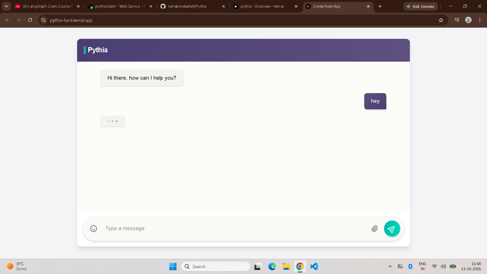
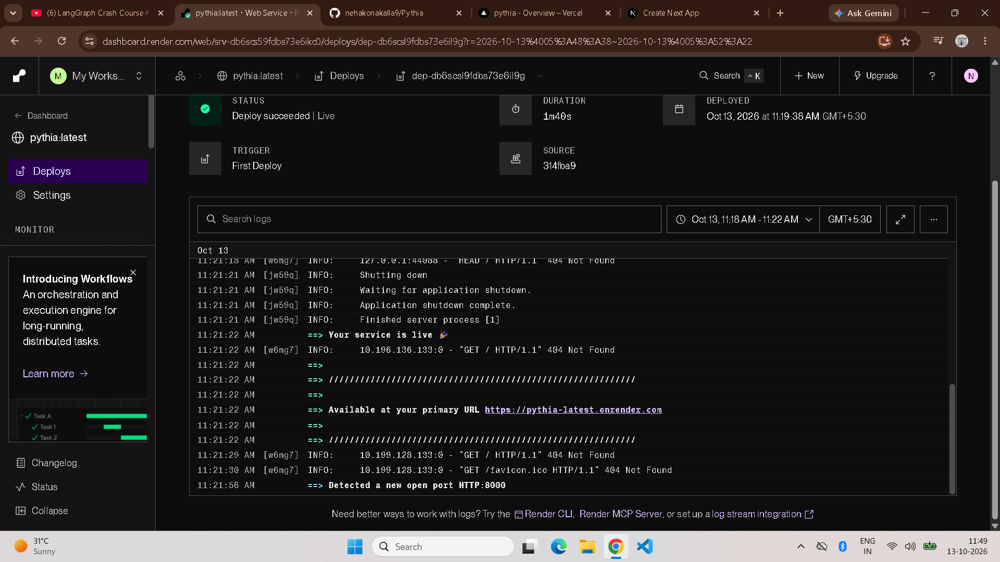
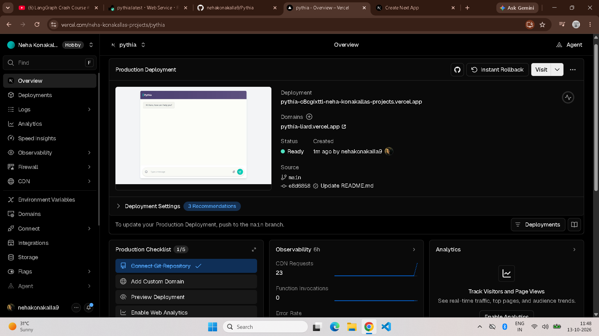

# Pythia: AI Research Assistant

Pythia is a search-powered AI assistant. Ask a question and it decides whether to search the web, shows you the sources it reads, and streams back an answer in real time.

**Live demo:** https://YOUR-VERCEL-URL.vercel.app
**Backend API docs:** https://pythia-latest.onrender.com/docs

> The backend runs on a free tier, so the first request after a period of inactivity can take 30-60 seconds while the server wakes up. Answers can also be slow when the Gemini free tier is busy.

## Features

- **Agent that chooses when to search.** A LangGraph agent decides whether a question needs a web search, and calls the Tavily search tool when it does.
- **Live progress in the UI.** The interface shows each stage as it happens: Searching, Reading (with the source links) and Writing.
- **Streaming answers.** Responses stream token by token over Server-Sent Events, so you see text as it is generated.
- **Conversation memory.** A checkpoint ID is passed between requests so follow-up questions keep their context.

## Tech stack

| Layer | Tools |
| --- | --- |
| Agent | LangGraph, LangChain, Google Gemini (`gemini-3.5-flash`), Tavily Search |
| Backend | Python, FastAPI, Uvicorn, Server-Sent Events |
| Frontend | Next.js, React, TypeScript, Tailwind CSS |
| Deployment | Docker, Docker Hub, Render (backend), Vercel (frontend) |

## Project structure

```
Pythia/
├── client/    # Next.js frontend
│   └── src/
│       ├── app/page.tsx            # chat page and streaming logic
│       └── components/             # Header, MessageArea, InputBar
└── server/    # FastAPI backend
    ├── app.py                      # LangGraph agent and /chat_stream endpoint
    ├── requirements.txt
    └── Dockerfile
```

## How it works

1. The frontend opens an `EventSource` connection to `GET /chat_stream/{message}`.
2. The backend runs the LangGraph agent. If a search is needed, it emits `search_start` and `search_results` events with the query and source URLs.
3. The answer is streamed back as `content` events, followed by an `end` event.
4. The frontend updates the stages and the message as each event arrives.

## Run it locally

You need Python 3.x, Node.js, a [Google AI Studio](https://aistudio.google.com/) API key and a [Tavily](https://tavily.com/) API key.

### Backend

```bash
cd server
python -m venv venv
# Windows: venv\Scripts\activate    macOS/Linux: source venv/bin/activate
pip install -r requirements.txt
```

Create `server/.env`:

```
GOOGLE_API_KEY=your_google_key
TAVILY_API_KEY=your_tavily_key
```

Start the server:

```bash
uvicorn app:app --port 8000
```

Open http://localhost:8000/docs to check that it is running.

### Frontend

```bash
cd client
npm install
```

Create `client/.env.local`:

```
NEXT_PUBLIC_API_URL=http://localhost:8000
```

Start the app:

```bash
npm run dev
```

Open http://localhost:3000.

## Run the backend with Docker

```bash
cd server
docker build -t pythia .
docker run -d -p 8000:8000 \
  -e GOOGLE_API_KEY=your_google_key \
  -e TAVILY_API_KEY=your_tavily_key \
  --name pythia-container pythia
```

API keys are passed at runtime and are never baked into the image.

## Deployment

- **Backend:** the Docker image is published to Docker Hub and deployed on Render as a web service, with the two API keys set as environment variables.
- **Frontend:** deployed on Vercel with the root directory set to `client` and `NEXT_PUBLIC_API_URL` pointing to the Render backend URL.

## Environment variables

| Variable | Where | Purpose |
| --- | --- | --- |
| `GOOGLE_API_KEY` | server | Gemini API access |
| `TAVILY_API_KEY` | server | Tavily web search |
| `NEXT_PUBLIC_API_URL` | client | Base URL of the backend (no trailing slash) |

## Screenshots

Pythia is deployed end to end: the Next.js frontend runs on Vercel and calls the FastAPI backend running as a Docker container on Render. The screenshots below show the app answering a question and both deployments live.

### Chat interface
Ask a question and Pythia searches the web, shows the sources it reads, and streams the answer.



### Backend on Render
The FastAPI backend, packaged as a Docker image, running as a live web service.



### Frontend on Vercel
The Next.js frontend deployed on Vercel and connected to the Render backend.


